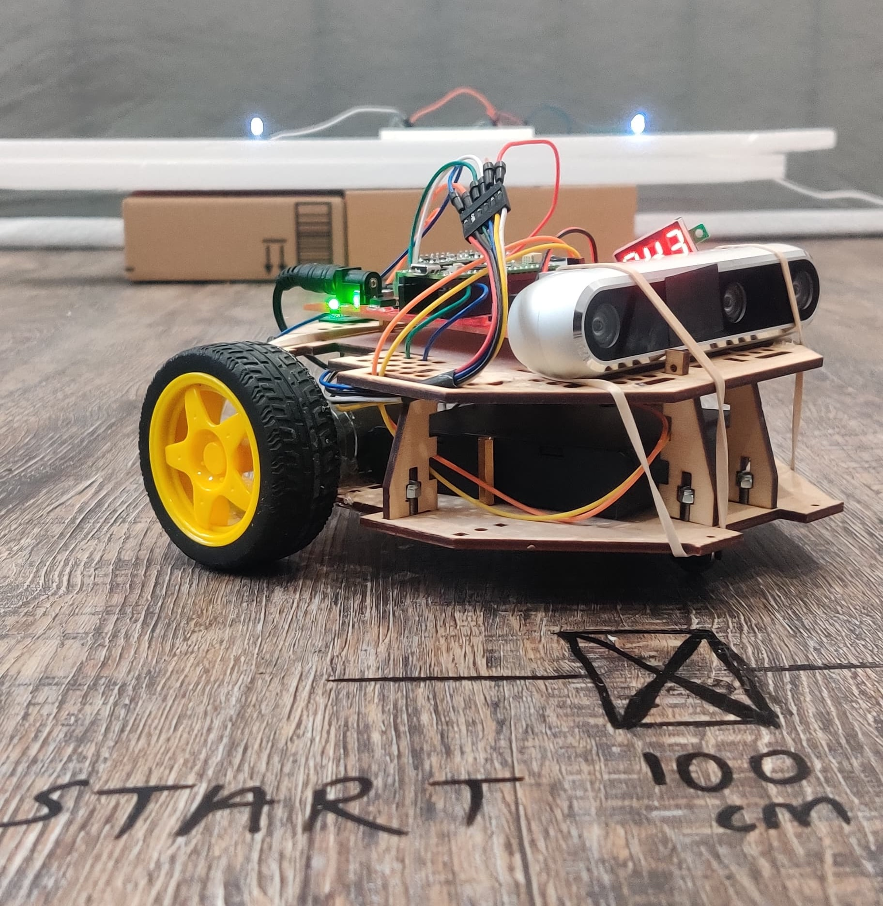
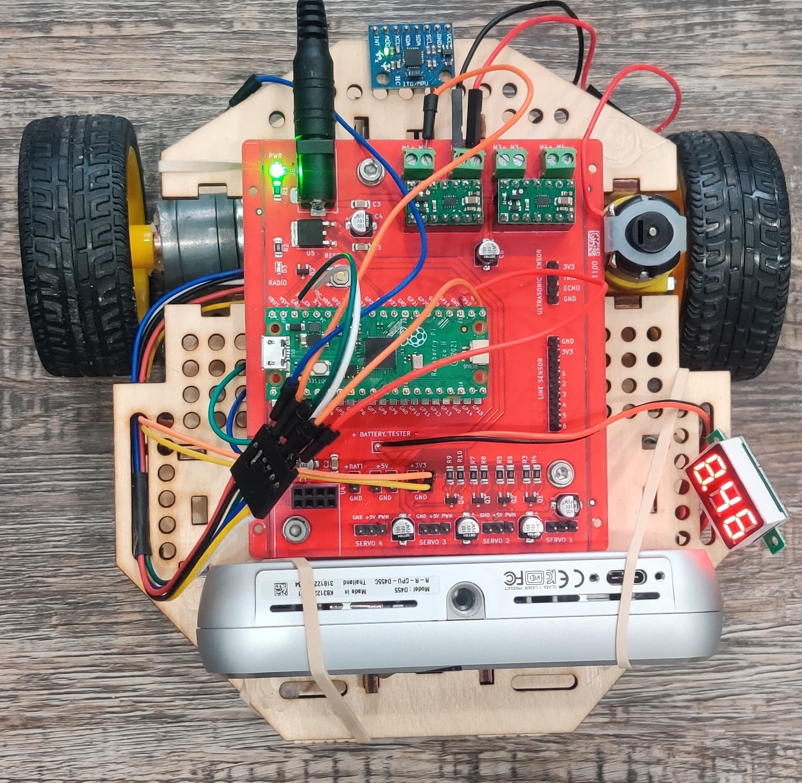

# Robot Localization with Visible Light Positioning and EKF Sensor Fusion

A differential-drive robot that combines wheel encoder and gyroscope measurements with LED beacon bearings for indoor localization.
A software lock-in detector uses a temporal FFT to detect 14.1 Hz beacons. An Extended Kalman Filter (EKF) fuses these observations with odometry.

<p align="center">
  
  
</p>

## Hardware

- Raspberry Pi Pico for motor control and sensor acquisition
- RealSense D455 RGB camera
- MPU-6050 gyroscope and one magnetic quadrature encoder
- Arduino with two LED beacons, spaced 0.4 m apart
- Laptop for beacon detection, sensor fusion, and visualization

## Results

Results reported from the original implementation and experiments:

| Experiment | Odometry error | Fused error | Reported reduction |
| :--- | :--- | :--- | :--- |
| Straight + Lateral + Backward | 6.4 cm | 2.0 cm | 69% |
| Leftward + Lateral + Backward | 8.1 cm | 4.2 cm | 48% |
| Loop Closure (Circle) | 13.1 cm | 4.6 cm | 65% |
| Multi-Turn Complex Path | 9.9 cm | 6.7 cm | 33% |
| **Reported average** | **9.4 cm** | **4.4 cm** | **53.8%** |

[View the original video demonstrations on Google Drive](https://drive.google.com/drive/folders/1QHP4I3WM6Vd3NnsBjABr5_gUo3e91IJ7?usp=sharing).

## Setup

Requires Python 3, a graphical desktop, and the connected robot and camera.
From the repository root on Linux or macOS:

```bash
python3 -m venv .venv
source .venv/bin/activate
python -m pip install -r requirements.txt
```

- Copy `code/pico/main.py` to the MicroPython Pico as `main.py`.
- Upload `code/beacon_driver/beacon_driver.ino` to the Arduino.
- Set `CAM_INDEX` in both host scripts for your camera.

## Run

Calibrate the beacon pixels:

```bash
python code/beacons_pixel_extractor.py
```

Press `y` to print the beacon x-coordinates. Press `q` to close.

Start the robot interface:

```bash
python code/final_robot.py --port <SERIAL_PORT> --calib <LEFT_X> <RIGHT_X>
```

Keep the robot stationary until `READY!` appears.

**Controls:** `w` forward · `x` backward · `a` left spin · `d` right spin · `s` stop · `q` quit

[Source code](code/) · [Experiment images](Results/Images_result_and_robot/)
